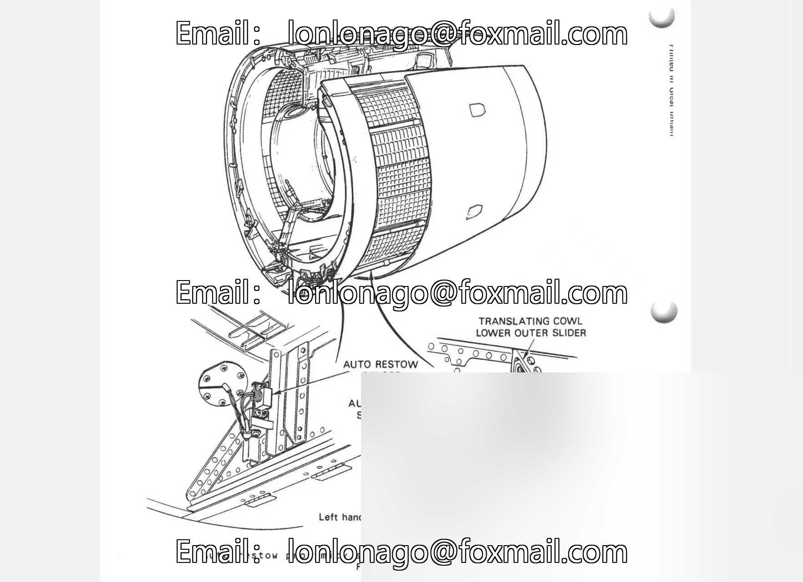
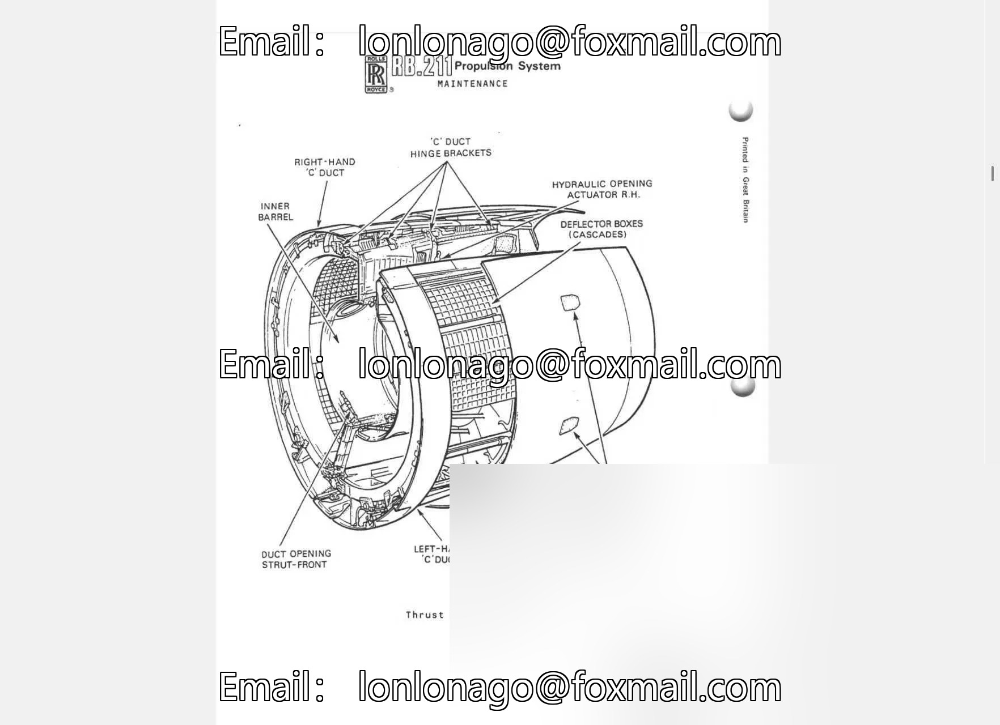
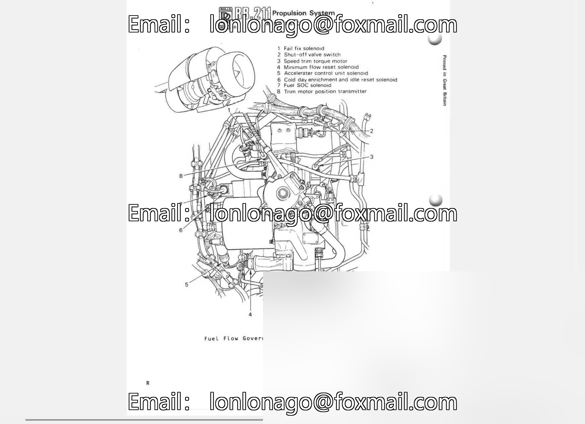
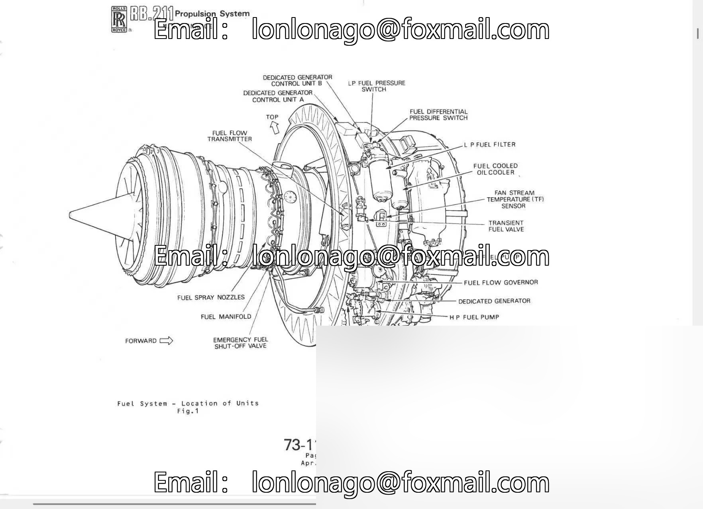
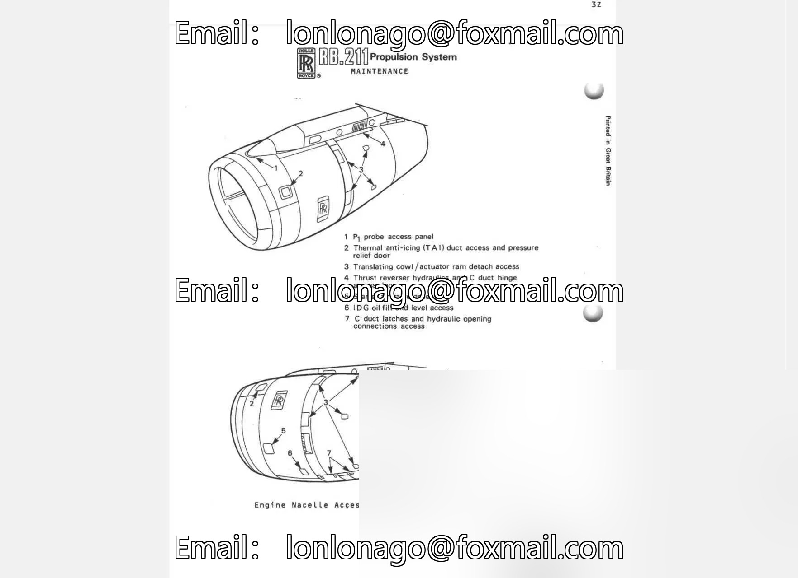
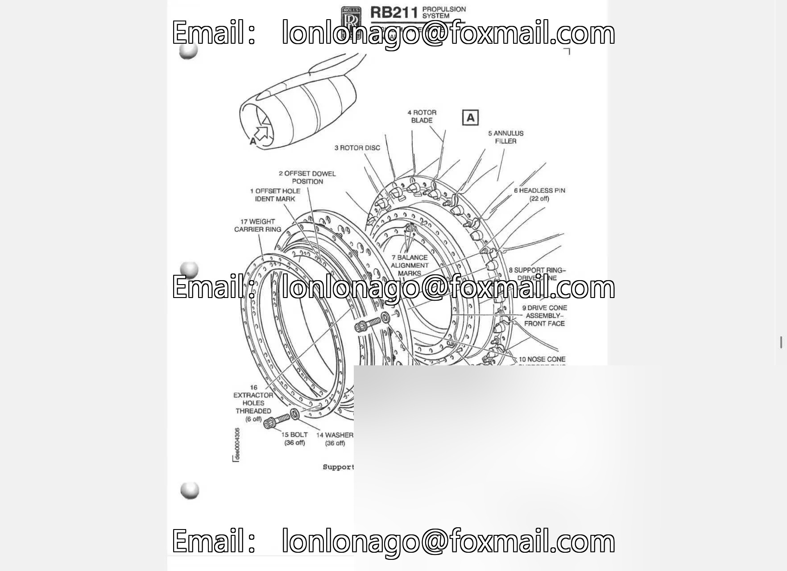
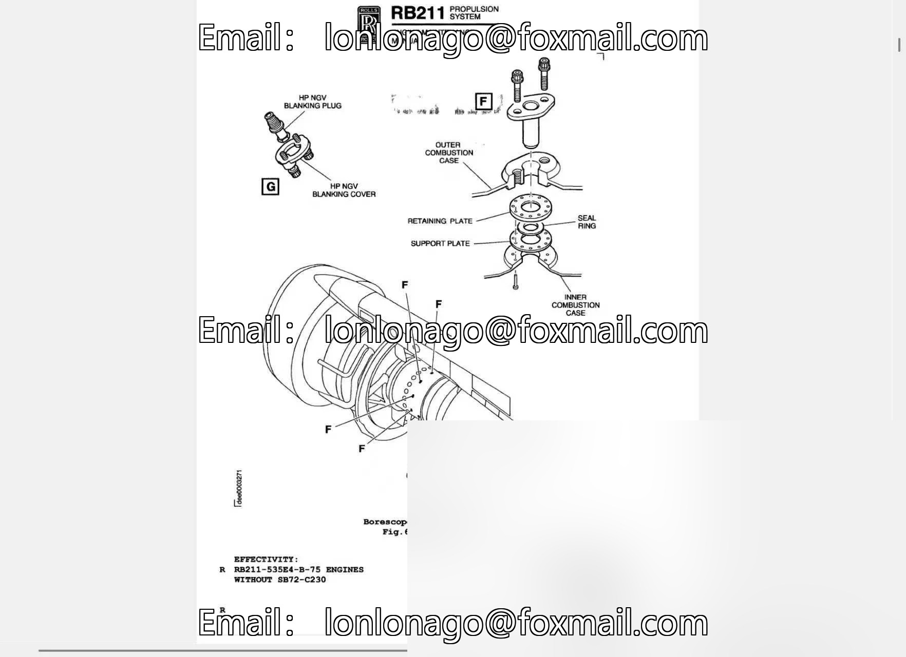

# Rolls-Royce RB211-535E4-B-75 engine maintenance manual

## Body

Rolls-Royce RB211-535E4-B-75 engine maintenance manual, 20 sets in total.
Tupolev TU-204 aircraft dedicated, 40th revision version
content covers engine structure, maintenance process, system principles, etc., suitable for reference in maintenance, maintenance, and technical research.
Materials are in PDF format, can be copied, cannot be returned or exchanged after sale.
Can be photographed directly, contact privately if there are issues.

The maintenance manual covers engine structure, maintenance procedures and system principles, totaling 20 volumes, in PDF format for repair, maintenance and technical reference use.

<!-- AI_ENRICHED -->

## Images

## Payment

Here is a pay link on Stripe ( https://buy.stripe.com/3cs8yP7sY87d0vu9AB ). Please contact me lonlonago@foxmail.com after funding $89, and I will send you a complete data files , thank you!

